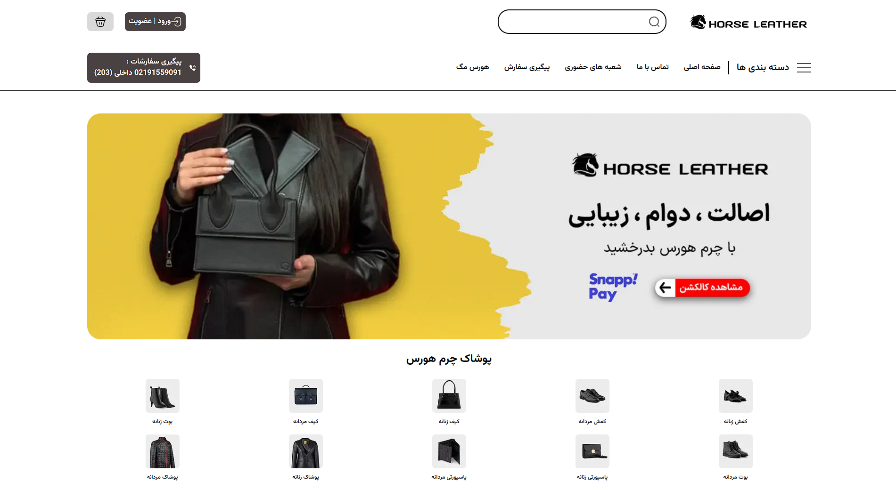

<div align="center">


<h1 align="center">Horse Leather</h1>

### Modern Leather E-commerce Store

A modern e-commerce experience for leather fashion and accessories.

<p align="center">
  
  
  
  
  
</p>

---
</div>

## 🛍️ About the project 

Horse Leather is an e-commerce web application for leather clothing and accessories.

The project is being developed to provide a complete online shopping experience, with features such as user authentication, shopping cart management, payment processing, and order management, supported by a robust database architecture.

## ✨ Features

- [x] Product Listing
- [x] Database Integration
- [ ] User Authentication
- [ ] Shopping Cart

---

## 🚀 Getting Started

### 1.prerequisites

Make sure you have the following installed:
- [node.js](https://nodejs.org/)
- npm (comes with Node.js)
- [Git](https://git-scm.com/)

### 2.installation

1. Clone the repository:

    1.Clone the repository
    ```bash

    git clone https://github.com/Avesta1387/horse-leather-exercises.git

    ```

    2.Navigate to the project directory
    ```bash

    cd horse-leather-exercises

    ```

    3.Install dependencies

    ```bash

    npm install

    ```

### 3.Environment Variables


Create a `.env.local` file the root directory:


```env

NEXT_PUBLIC_SUPABASE_URL=your_supabase_url
NEXT_PUBLIC_SUPABASE_ANON_KEY=your_supabase_key

```

### 4.Run Development Server

```md

Start the development server:

```

```bash

npm run dev

```

---

## 📸 Screenshots

### Homepage



---

## 🛠️ Tech Stack

| Technology | Purpose |
|---|---|
| Next.js | React framework for building the applicaion |
| React | Building user interface |
| TypeScript | Type-safe development |
| Tailwind CSS | Styling and responsive design | 
| Supabase | Database and backend services|

---

## 🗺️ Roadmap

- [x] Product Listing
- [x] Database Integration
- [ ] User Authentication
- [ ] Shopping Cart
- [ ] Product Filtering and Sorting
- [ ] Favorites
- [ ] Checkout and Payment
- [ ] Order Management
- [ ] User Profile

---

## 📄 License

#### This project is licensed under the [MIT License](./LICENSE).